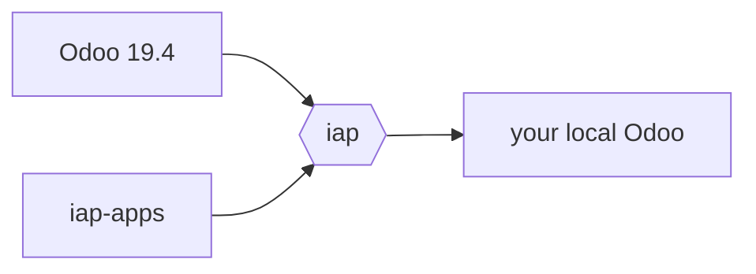

# iap

Run Odoo's AI service (IAP) on your machine, so your local Odoo databases can use AI.




`iap` runs the iap-apps AI service on Odoo 19.4, and points your local Odoo at it.

## Install

```bash
uv tool install git+ssh://git@github.com/nd-dew/iap.git
```

## Usage

```bash
iap start           # start the local IAP service
iap connect --all   # point your local Odoo databases at it
iap logs -f         # watch it work
```

See `iap --help` for the rest.

The service runs in `ODOO_AI_TEST_MODE` (no credit checks) and uses the provider
keys from your environment (`OPENAI_API_KEY`, and `GEAP_SERVICE_ACCOUNT` for Vertex / Gemini).
The first start creates its database and installs `odoo_ai`.

## Configuration

All optional, via environment variables:

| Variable | Default |
| --- | --- |
| `IAP_ODOO_DIR` | `~/repos/Odoo/wt/saas-19.4` (Odoo the service runs on, with `odoo/` and `enterprise/`) |
| `IAP_APPS_DIR` | `~/repos/iap-apps` |
| `IAP_PYTHON` | `$IAP_ODOO_DIR/.venv/bin/python` |
| `IAP_PORT` | `8086` |
| `IAP_DB` | `iap` |

State (pid file, log) lives in `~/.local/state/iap/`.
`iap_ai`'s own Python requirements are layered on top of the Odoo venv for each run,
so that venv is never modified.
