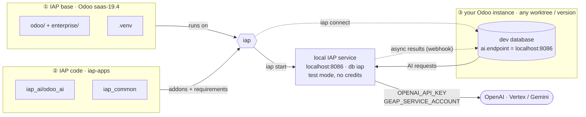

# iap

Run the Odoo AI IAP service (`iap-apps/iap_ai`) locally, so dev databases can use
AI features without the public `ai.api.odoo.com` (which can't call back into localhost).


## How it fits together

Local Odoo AI development needs three things wired up. `iap` does the wiring:



1. **IAP base**: the IAP service is itself an Odoo app, so it needs an Odoo to run on
   (here `saas-19.4`, the version `iap-apps` targets), with its Python environment.
2. **IAP code**: `iap-apps` provides the `odoo_ai` service module and its shared tooling.
   `iap start` loads them on top of the base, adding their Python requirements for that run only.
3. **Your Odoo instance**: whichever worktree you are developing in, on any version.
   `iap connect` points its database's `ai.endpoint` at the local service; since both
   run on your machine, the service can also call back into it with async results.

## Install

```bash
uv tool install -e ~/repos/iap
```

## Usage

```bash
iap                 # start it, or show status + recent logs if already running
iap connect <db>    # point a dev database's ai.endpoint at the local IAP
iap connect <db> --reset   # back to the public endpoint
iap connect --all   # every local DB with ai installed (skips ones set to another endpoint, unless --force)
iap status          # status, how odoo / enterprise / iap-apps compare to upstream, recent logs
iap fetch           # fetch upstream first, for fresh 'behind' counts (or: iap status --fetch)
iap logs -f         # follow the log
iap restart -u      # restart and update odoo_ai (e.g. after switching iap-apps branch)
iap stop
```

The service runs in `ODOO_AI_TEST_MODE` (no credit checks) and uses the provider
keys from your environment (`OPENAI_API_KEY`, and `GEAP_SERVICE_ACCOUNT` for Vertex / Gemini).
The first start creates its database and installs `odoo_ai`.

## Configuration

All optional, via environment variables:

| Variable | Default |
| --- | --- |
| `IAP_ODOO_DIR` | `~/repos/Odoo/wt/saas-19.4` (Odoo the service runs on, with `odoo/` and `enterprise/`) |
| `IAP_APPS_DIR` | `~/repos/iap-apps` |
| `IAP_PYTHON` | `$IAP_ODOO_DIR/.venv/bin/python` |
| `IAP_PORT` | `8086` |
| `IAP_DB` | `iap` |

State (pid file, log) lives in `~/.local/state/iap/`.
`iap_ai`'s own Python requirements are layered on top of the Odoo venv for each run,
so that venv is never modified.
