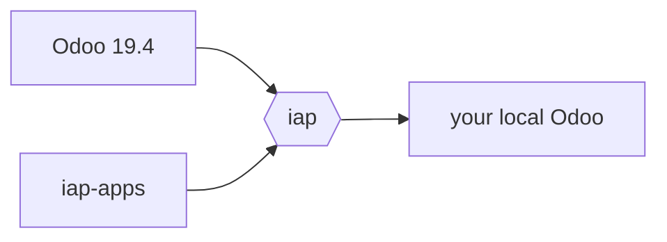

# iap

`iap` is a script that runs iap-apps on Odoo 19.4, and points your local Odoo at it.

Extra sparkles:
- Tells you when your local IAP code is stale
- Shows the IAP logs
- Runs in the background (not attached to a terminal)




## Install

```bash
uv tool install git+https://github.com/nd-dew/iap
```

## Usage

```bash
iap start           # start the local IAP service
iap connect --all   # point your local Odoo databases at it
iap logs -f         # watch it work
```

See `iap --help` for the rest.

## How it works

The IAP service is just an Odoo module from iap-apps. `iap start` runs it on its own
Odoo 19.4 server in the background. It uses your own AI keys (`OPENAI_API_KEY`,
`GEAP_SERVICE_ACCOUNT`), and skips credit checks.

`iap connect` tells your local databases to send their AI requests to this server
instead of Odoo's.

## Assumptions

`iap` doesn't set anything up for you. It expects:

- **Linux or macOS**, with `uv`, `git` and `psql` installed
- **A local PostgreSQL** you can use without a password (like a normal Odoo dev setup)
- **Odoo 19.4** in `~/repos/Odoo/wt/saas-19.4/odoo`, with a ready Python venv in
  `~/repos/Odoo/wt/saas-19.4/.venv` (the [odoo-wt](https://github.com/nd-dew/odoo-wt) layout)
- **iap-apps** cloned in `~/repos/iap-apps`, on the `saas-19.4` branch (private repo, needs access)
- **Your AI keys** in the environment: `OPENAI_API_KEY` and `GEAP_SERVICE_ACCOUNT`
- **Port 8086** free

Different paths or port? See [Configuration](#configuration).

## Configuration

All optional, via environment variables:

| Variable | Default |
| --- | --- |
| `IAP_ODOO_DIR` | `~/repos/Odoo/wt/saas-19.4` (Odoo the service runs on: `odoo/`, and `enterprise/` if present, which is optional) |
| `IAP_APPS_DIR` | `~/repos/iap-apps` |
| `IAP_PYTHON` | `$IAP_ODOO_DIR/.venv/bin/python` |
| `IAP_PORT` | `8086` |
| `IAP_DB` | `iap` |

State (pid file, log) lives in `~/.local/state/iap/`.
`iap_ai`'s own Python requirements are layered on top of the Odoo venv for each run,
so that venv is never modified.
